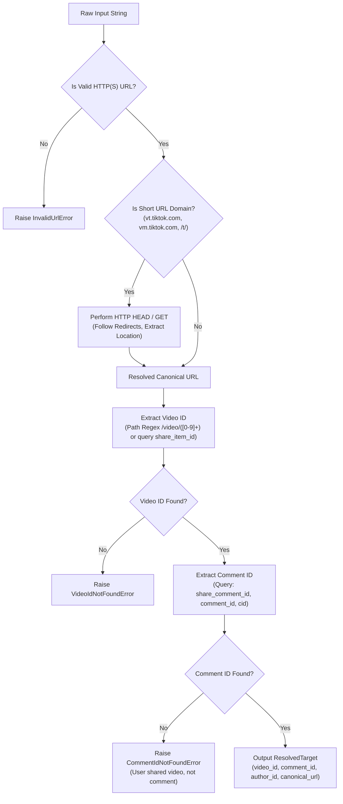

# Phase A — TikTok Comment Link Analysis

## 1. Objective & Scope
The objective of Phase A is to dissect, reverse-engineer, and formally specify how TikTok encodes, shares, and redirects comment links. A bulletproof link resolver must handle all share variants without silently dropping the comment identifier.

---

## 2. Empirical Link Tracing

### Primary Test Subject
- **Input Short URL**: `https://vt.tiktok.com/ZS9f3yqSf57UR-naeU1/`
- **Video ID**: `7708356144804236564`
- **Target Comment ID**: `7708394712596972308`

### Live Redirect Trace Execution
Executing an HTTP request following redirect hops reveals:

```text
Request: GET https://vt.tiktok.com/ZS9f3yqSf57UR-naeU1/
Status:  301 Moved Permanently
Location: https://www.tiktok.com/@nyariprompt/video/7708356144804236564?
          _d=secCgYIASAHKAESPgo8hQWv0awaIJgXheQt4nDUoye5V06Je%2FJxcU8NQSTEWP3A7Yn6q2GC7ABBKLirC%2BW2iDISo8qDEh8PqF3fGgA%3D
          &_r=1
          &_svg=1
          &checksum=a3607fe7df310dc6775fdf23717a401a89efa44f0e39df22f961f5b9a1b8750c
          &comment_author_id=7435664412436120631
          &item_author_type=2
          &mid=7708356178216635154
          &panel_source_v2=long_press_comment
          &preview_pb=0
          &region=ID
          &sec_user_id=MS4wLjABAAAACmoHW8OcExuxx_9D0ip79oYkaI2aTefVxKkjovmoVsIYtK1AuPqQt8BDlNNGiR66
          &share_app_id=1180
          &share_comment_id=7708394712596972308
          &share_enter_from=homepage_hot
          &share_item_id=7708356144804236564
          &share_link_id=60e8fde2-fb9e-4453-a897-8e8ed7135572
          &share_region=ID
          &share_scene=16
          &sharer_language=en
          &social_share_type=19
          &source=h5_t
          &sp_level=1
          &timestamp=1794871861
          &u_code=ddg8gh7kcm341i
          &ug_btm=b6880%2Cb2001
          &ugbiz_name=SOCIAL
          &user_id=6852969367613932546
          &utm_campaign=client_share
          &utm_medium=android
          &utm_source=copy
```

---

## 3. Dissecting the Parameter Hierarchy

| Parameter | Value in Trace | Significance in StickerDrop |
| :--- | :--- | :--- |
| **`share_comment_id`** | `7708394712596972308` | **CRITICAL**: The exact 64-bit numeric ID of the shared comment. |
| **`share_item_id`** | `7708356144804236564` | **CRITICAL**: The exact video ID (`aweme_id`). |
| Path video ID | `/video/7708356144804236564` | Canonical video identifier in the URL path. |
| `comment_author_id` | `7435664412436120631` | TikTok internal user ID of the comment author. |
| `panel_source_v2` | `long_press_comment` | Confirms user shared via comment long-press menu. |
| `social_share_type` | `19` | Internal code for comment-level link share. |
| `utm_source` | `copy` | Generated by "Copy Link" action in the mobile app. |

---

## 4. Supported TikTok URL Formats

StickerDrop's link resolver must recognize and parse:

1. **Short Domain Comment Share**:
   `https://vt.tiktok.com/ZS9f3yqSf57UR-naeU1/`
   `https://vm.tiktok.com/ZMxxxxxx/`
2. **Canonical Desktop/Web Comment URL**:
   `https://www.tiktok.com/@username/video/7708356144804236564?share_comment_id=7708394712596972308`
   `https://www.tiktok.com/@username/video/7708356144804236564?comment_id=7708394712596972308`
   `https://www.tiktok.com/@username/video/7708356144804236564?cid=7708394712596972308`
3. **Alternative Path Schemas**:
   `https://m.tiktok.com/v/7708356144804236564.html?share_comment_id=7708394712596972308`
   `https://www.tiktok.com/t/ZTxxxxxxxx/?share_comment_id=...`

---

## 5. Resolution & Parsing Algorithm



### URL Normalization Rules
1. Strip all trailing whitespace, unicode zero-width spaces, and copy-paste noise.
2. If text contains extraneous text (e.g., `"Check out this comment: https://vt.tiktok.com/..."`), extract the first matching HTTP(S) URL via regex.
3. If domain is `vt.tiktok.com`, `vm.tiktok.com`, or `tiktok.com/t/`, follow HTTP 301/302 redirects to extract the canonical destination URL.
4. Normalize video ID into a canonical numeric string (e.g., `7708356144804236564`).
5. Normalize comment ID into a canonical numeric string (e.g., `7708394712596972308`).

---

## 6. Edge Cases & Safeguards

1. **User shares the Video instead of the Comment**:
   - URL: `https://vt.tiktok.com/ZSpG1m4EG/`
   - Result: Resolves to `video_id = 7708356144804236564`, but `share_comment_id` is missing.
   - Behavior: The resolver must explicitly detect `comment_id is None` and return a user-friendly error: `"The link is a video link, not a comment link. Please long-press the specific comment and tap Copy Link."`
2. **Redirect Truncation / Network Failure**:
   - If network times out, retry with backoff up to 2 times.
3. **Tracking Parameter Junk**:
   - Strip all non-essential query parameters (`_d`, `checksum`, `sec_user_id`, `utm_*`) to produce a clean canonical reference.
