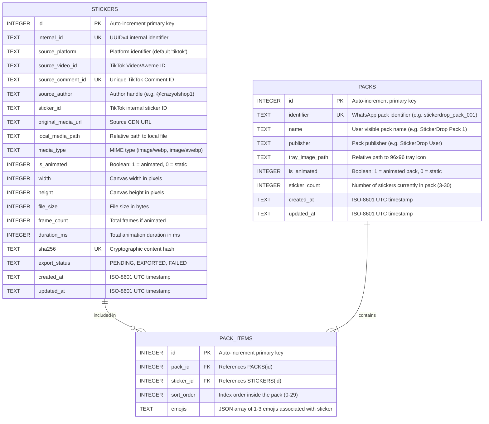

# Phase D — Persistent Sticker Library & Storage Architecture

## 1. Storage Architecture
StickerDrop maintains a single unified library of stickers across all user sessions. The storage layer comprises:
1. **SQLite Relational Database (`stickerdrop.db`)**: Stores metadata, relations, download timestamps, WhatsApp export status, and foreign keys.
2. **Local Filesystem Media Repository (`media/`)**: Stores immutable media files named by their cryptographic SHA-256 hash (e.g., `media/3a7b9c...awebp`).

---

## 2. Entity Relationship Diagram



---

## 3. SQLite DDL Schema

```sql
CREATE TABLE IF NOT EXISTS schema_migrations (
    version INTEGER PRIMARY KEY,
    applied_at TEXT NOT NULL
);

CREATE TABLE IF NOT EXISTS stickers (
    id INTEGER PRIMARY KEY AUTOINCREMENT,
    internal_id TEXT NOT NULL UNIQUE,
    source_platform TEXT NOT NULL DEFAULT 'tiktok',
    source_video_id TEXT NOT NULL,
    source_comment_id TEXT NOT NULL UNIQUE,
    source_author TEXT NOT NULL,
    sticker_id TEXT,
    original_media_url TEXT NOT NULL,
    local_media_path TEXT NOT NULL,
    media_type TEXT NOT NULL,
    is_animated INTEGER NOT NULL DEFAULT 0,
    width INTEGER NOT NULL,
    height INTEGER NOT NULL,
    file_size INTEGER NOT NULL,
    frame_count INTEGER NOT NULL DEFAULT 1,
    duration_ms INTEGER NOT NULL DEFAULT 0,
    sha256 TEXT NOT NULL UNIQUE,
    export_status TEXT NOT NULL DEFAULT 'PENDING',
    created_at TEXT NOT NULL,
    updated_at TEXT NOT NULL
);

CREATE INDEX IF NOT EXISTS idx_stickers_source_comment_id ON stickers(source_comment_id);
CREATE INDEX IF NOT EXISTS idx_stickers_sha256 ON stickers(sha256);
CREATE INDEX IF NOT EXISTS idx_stickers_export_status ON stickers(export_status);

CREATE TABLE IF NOT EXISTS packs (
    id INTEGER PRIMARY KEY AUTOINCREMENT,
    identifier TEXT NOT NULL UNIQUE,
    name TEXT NOT NULL,
    publisher TEXT NOT NULL DEFAULT 'StickerDrop User',
    tray_image_path TEXT NOT NULL,
    is_animated INTEGER NOT NULL DEFAULT 0,
    sticker_count INTEGER NOT NULL DEFAULT 0,
    created_at TEXT NOT NULL,
    updated_at TEXT NOT NULL
);

CREATE TABLE IF NOT EXISTS pack_items (
    id INTEGER PRIMARY KEY AUTOINCREMENT,
    pack_id INTEGER NOT NULL REFERENCES packs(id) ON DELETE CASCADE,
    sticker_id INTEGER NOT NULL REFERENCES stickers(id) ON DELETE CASCADE,
    sort_order INTEGER NOT NULL DEFAULT 0,
    emojis TEXT NOT NULL DEFAULT '["🔥"]',
    UNIQUE(pack_id, sticker_id),
    UNIQUE(pack_id, sort_order)
);
```

---

## 4. Deduplication Strategy

1. **Comment-Level Deduplication**:
   If a user pastes the same TikTok comment URL again, `source_comment_id` collides with the unique constraint. The repository detects this and immediately returns the existing record without re-downloading or re-calling third-party APIs.
2. **Media-Level Deduplication**:
   If different comments in different videos share the exact same sticker (e.g. the viral Prabowo meme used in 500 different comment sections), the SHA-256 hash detects that the binary asset already exists on disk. The repository creates a reference or returns the existing record, avoiding redundant storage consumption.

---

## 5. Integrity & Interruption Recovery

1. **Atomic File Writes**:
   Media files are downloaded to temporary files (`media/tmp_xxx`) and renamed to their permanent SHA-256 path only after download completion and SHA-256 verification. This prevents half-downloaded or corrupt files.
2. **Startup Health Check**:
   The repository includes an integrity scanner `verify_library_integrity()` that verifies:
   - For every DB row, the local file exists at `local_media_path`.
   - The file size matches `file_size`.
   - The file's computed SHA-256 matches the database `sha256`.
   - Any corrupt or missing files are flagged for re-download.
