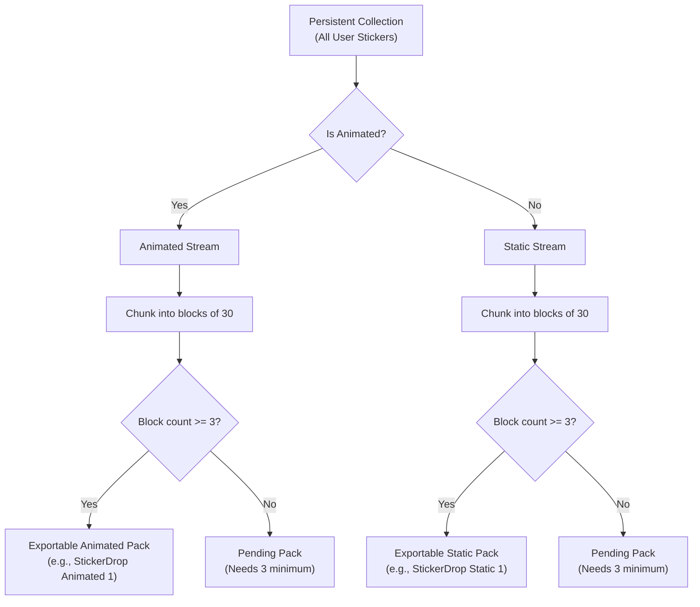

# Phase E — WhatsApp Sticker Export Architecture

## 1. Official WhatsApp Android Sticker Specification
WhatsApp specifies strict technical parameters for custom sticker pack integration on Android via the official WhatsApp Stickers API (`com.whatsapp.stickers`).

### Hard Technical Constraints

| Parameter | WhatsApp Requirement | Enforced by StickerDrop |
| :--- | :--- | :--- |
| **Canvas Dimensions** | Exactly **512 × 512 pixels** | Enforced via pre-export validator |
| **Static File Size** | Max **100 KB** (102,400 bytes) | Enforced via validator |
| **Animated File Size** | Max **500 KB** (512,000 bytes) | Enforced via validator |
| **File Format** | WebP (`.webp`) | Enforced |
| **Animation Mixing Rule** | **STRICT ISOLATION**: A pack must be 100% static OR 100% animated. Mixing is prohibited by WhatsApp! | Enforced: partitioner creates separate static and animated packs |
| **Pack Sticker Count** | **Minimum 3 stickers, Maximum 30 stickers** | Partitioning algorithm enforces $3 \le N \le 30$ |
| **Tray Icon** | Exactly **96 × 96 pixels**, max **50 KB**, static PNG/WebP | Generated automatically from the first sticker in the pack |
| **Emojis per Sticker** | 1 to 3 emojis per sticker | Auto-assigned based on reaction tags |
| **Padding** | 16 px transparent border | Required to prevent clipping |

---

## 2. Dynamic Virtual Pack Partitioning Algorithm

The user experience dictates a **single persistent library**, but WhatsApp enforces a **3 to 30 sticker limit per pack** and **no mixing of animated and static stickers**.

### Partitioning Rules:
1. Divide the user's collection into two distinct streams:
   - Stream A: `Animated Stickers`
   - Stream B: `Static Stickers`
2. Group each stream into chunks of 30 stickers:
   - Pack 1: Items 1 to 30
   - Pack 2: Items 31 to 60
   - ...
3. Tail Pack Handling:
   - If the final chunk contains fewer than 3 stickers (e.g. 1 or 2 stickers), mark the pack status as `INCOMPLETE` (needs $3 - N$ more stickers to export).
   - Display a clean UI progress indicator: `"2 of 3 stickers needed to export this pack"`.



---

## 3. WhatsApp `contents.json` Metadata Schema

```json
{
  "android_play_store_link": "https://play.google.com/store/apps/details?id=com.stickerdrop.app",
  "ios_app_store_link": "",
  "sticker_packs": [
    {
      "identifier": "stickerdrop_pack_anim_001",
      "name": "StickerDrop Memes 1",
      "publisher": "StickerDrop",
      "tray_image_file": "tray_icon.png",
      "publisher_email": "support@stickerdrop.app",
      "publisher_website": "https://stickerdrop.app",
      "privacy_policy_website": "https://stickerdrop.app/privacy",
      "license_agreement_website": "https://stickerdrop.app/terms",
      "animated_sticker_pack": true,
      "stickers": [
        {
          "image_file": "7708394712596972308.webp",
          "emojis": ["🔥", "🗿"]
        },
        {
          "image_file": "7708412345678901234.webp",
          "emojis": ["😂"]
        },
        {
          "image_file": "7708523456789012345.webp",
          "emojis": ["👍"]
        }
      ]
    }
  ]
}
```

---

## 4. Android ContentProvider Architecture

On Android, StickerDrop must expose a custom `ContentProvider`:

```xml
<provider
    android:name="com.stickerdrop.app.WhatsAppStickerContentProvider"
    android:authorities="${applicationId}.stickercontentprovider"
    android:enabled="true"
    android:exported="true"
    android:readPermission="com.whatsapp.sticker.READ" />
```

### Export Intent Invocation
When the user taps "Add to WhatsApp", the application sends the standard intent:

```java
Intent intent = new Intent();
intent.setAction("com.whatsapp.intent.action.ENABLE_STICKER_PACK");
intent.putExtra(EXTRA_STICKER_PACK_ID, packIdentifier);
intent.putExtra(EXTRA_STICKER_PACK_AUTHORITY, BuildConfig.APPLICATION_ID + ".stickercontentprovider");
intent.putExtra(EXTRA_STICKER_PACK_NAME, packName);
try {
    startActivityForResult(intent, ADD_PACK_REQUEST_CODE);
} catch (ActivityNotFoundException e) {
    // Check for WhatsApp Business (com.whatsapp.w4b) or prompt to install WhatsApp
}
```
