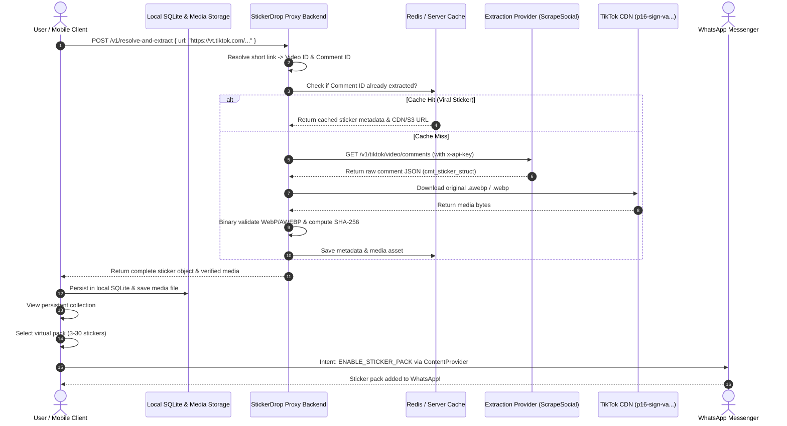

# Phase F — End-to-End System Architecture

## 1. Architectural Strategy Evaluation

| Evaluation Criteria | Local-Only (Direct Phone-to-TikTok) | Pure Backend (Cloud-Only Storage) | Hybrid (Backend Extraction + Local Storage) |
| :--- | :--- | :--- | :--- |
| **TikTok Anti-Bot & WAF Handling** | **Fails**: Phone IPs rapidly flagged by Slardar WAF; cannot rotate proxies cleanly. | **Succeeds**: Backend leverages managed extraction pools (ScrapeSocial/Apify). | **Succeeds**: Backend handles extraction safely without client exposure. |
| **API Key Security** | **Critical Security Flaw**: Embedding API secrets in client APK allows extraction via decompilation. | **Secure**: Secrets reside strictly on server. | **Secure**: Secrets reside strictly on backend server environment. |
| **Extraction Cost per User** | High (every phone makes fresh scraper calls). | Low (server caches viral stickers). | **Optimal**: Server caches viral stickers by `source_comment_id`; client stores offline copy. |
| **User Privacy** | High (everything stays local). | Low (server tracks every user's personal collection). | **High**: User collection is stored locally in client SQLite database. |
| **Offline Usability** | Cannot browse if offline. | Cannot browse or export if offline. | **Succeeds**: Full offline browsing and WhatsApp export from local storage. |
| **Verdict** | **REJECTED** | **REJECTED** | **RECOMMENDED ARCHITECTURAL CHOICE** |

---

## 2. Recommended Hybrid Architecture

---

## 3. Component Breakdown & Input/Output Contracts

### 1. Link Resolver (`src/link_resolver/`)
- **Input**: Raw text or short URL string (e.g. `https://vt.tiktok.com/ZS9f3yqSf57UR-naeU1/`).
- **Processing**: Normalization, redirect resolution, regex extraction.
- **Output**: `ResolvedTarget` dataclass:
  - `video_id: str` (e.g. `"7708356144804236564"`)
  - `comment_id: str` (e.g. `"7708394712596972308"`)
  - `author_id: Optional[str]`
  - `resolved_url: str`

### 2. Extraction Engine & Adapter (`src/extraction/`)
- **Input**: `ResolvedTarget`.
- **Processing**: Dispatches to configured provider (`ScrapeSocial`, `ScrapeCreators`, `Apify`, or `Mock`). Manages pagination, comment thread traversal, and error wrapping.
- **Output**: `ExtractionResult` dataclass:
  - `comment_id: str`
  - `author_handle: str`
  - `comment_text: str`
  - `sticker_id: str`
  - `is_animated: bool`
  - `animated_url: Optional[str]`
  - `static_url: Optional[str]`
  - `raw_media_url: str`

### 3. Media Downloader & Validator (`src/media/`)
- **Input**: Media URL + raw bytes.
- **Processing**: Pure-Python RIFF parsing, chunk verification (`VP8X`, `ANIM`, `ANMF`), dimensions, frame count, duration, SHA-256 hash calculation.
- **Output**: `MediaValidationResult` dataclass:
  - `is_valid_webp: bool`
  - `is_animated: bool`
  - `width: int`, `height: int`
  - `file_size: int`
  - `frame_count: int`
  - `duration_ms: int`
  - `sha256: str`
  - `whatsapp_compliant: bool`

### 4. Persistent Storage Repository (`src/storage/`)
- **Input**: Validated media bytes + metadata.
- **Processing**: Deduplication check by `source_comment_id` and `sha256`, atomic file write, SQLite insertion.
- **Output**: `StickerRecord` database entity with permanent `internal_id`.

### 5. WhatsApp Pack Generator (`src/whatsapp_export/`)
- **Input**: List of stored `StickerRecord` objects.
- **Processing**: Partitioning into isolated animated vs static packs, 3–30 count verification, 96×96 tray icon generation, `contents.json` creation.
- **Output**: Validated `WhatsAppPack` directory ready for Android `ContentProvider` consumption.
